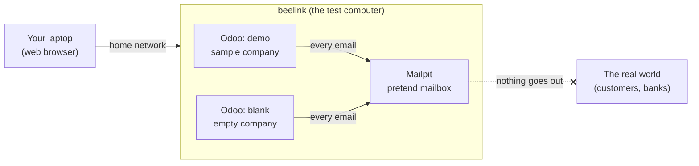

# CEO: Odoo

A plain-English guide to the Odoo test setup: what it is, how to open
it, and how to try things in it without breaking anything that matters.
No technical background needed. The [technical page](odoo.md) is for
whoever runs the machine.

<iframe src="slides/ceo-odoo.html" title="Odoo for local testing, slide deck"
  style="width: 100%; aspect-ratio: 16 / 9; border: 0;"
  allowfullscreen></iframe>

<a href="slides/ceo-odoo.html">Open the slides full screen</a>
(arrow keys to move, <kbd>F</kbd> for full screen).

## The short version

- **Odoo** is a business application: sales, CRM, invoicing, inventory,
  projects, all in one place, used through a web browser.
- **beelink** is a small computer in the house. It runs Odoo for
  **testing only**. No customer, supplier or bank ever sees it.
- **Mailpit** is a pretend mailbox. Every email Odoo "sends" lands there
  instead of going out, so you can read it, and nobody else gets it.
- Anything you do can be **wiped and started fresh in seconds**. You
  cannot break it in a way that lasts.

!!! tip "If you remember one thing"
    This is a sandbox. Click everything. Send the invoice. Delete the
    customer. Nothing leaves the house, and it can all be put back.

## If you know a LAMP server

You have run this shape before. Same idea, newer parts:

| The classic setup | Here |
| --- | --- |
| A server in the back room | beelink, a mini PC on the home network |
| Apache serving the site | nginx, a web server that does the same job |
| MySQL holding the data | PostgreSQL, another database, one per test system |
| The PHP application | Odoo, written in Python |
| A test mail server nobody reads | Mailpit, which you *do* read, in the browser |
| Restoring last night's backup to undo a test | one command that resets the test system in seconds |

You never touch any of these parts. You use the browser; the person who
runs beelink takes care of the rest.

## What is on beelink

There are two test systems. Each is its own complete Odoo with its own
data; what you do in one does not show up in the other.

| Name | Address (from your laptop) | What it is for |
| --- | --- | --- |
| **demo** | `https://demo.odoo.beelink.home.arpa` | a made-up company already full of sample customers, products, orders and invoices; best for looking around and trying workflows |
| **blank** | `https://blank.odoo.beelink.home.arpa` | an empty company; best for setting things up the way *your* business would, from scratch |
| **Mailpit** | `https://mail.odoo.beelink.home.arpa` | every email either system sent |

`https://odoo.beelink.home.arpa` is a start page that links all three.

## Logging in

1. Open one of the addresses above in your browser (Edge or Chrome).
2. User name: **admin**.
3. Password: ask the person who runs beelink. It is the same for both
   test systems and does not change when a system is reset.

The first time on a new laptop, someone has to do a one-time setup so
the laptop can find beelink and trusts its padlock (the steps are on
[Reaching Odoo from other machines](odoo-access.md)). After that it just
works. If the browser ever says *"Your connection isn't private"*, stop
and ask: it means that setup is missing or out of date, not that
something is wrong with Odoo.

The **"neutralized database"** notice at the top of the screen is
expected. It is Odoo's way of saying "this is a test copy, outside
connections are off".

## Mailpit: where the emails go

In a real business, Odoo emails customers all the time: quotes,
invoices, order confirmations, payment reminders, password resets. In a
test system full of made-up (and sometimes real-looking) addresses, that
would be a disaster.

So on beelink, **no email ever leaves the house**. Odoo hands every
message to Mailpit instead, and Mailpit keeps it, like a post office
that puts every letter in a tray rather than sending it.

To see what Odoo sent:

1. Do something in Odoo that sends an email, for example open a
   quotation and click **Send** (called *Send by Email* in some
   versions), then **Send** again in the window that opens.
2. Open `https://mail.odoo.beelink.home.arpa`.
3. The newest message is at the top. Click it to read it exactly as the
   customer would have received it, attachments (the PDF quote or
   invoice) included.

This is the useful part: you can check the wording, the layout and the
attachments of every email *before* anything like it goes to a real
customer.

!!! note "Not there yet?"
    Most emails show up at once, but Odoo sends some in batches. If a
    message is missing, wait a few minutes and refresh the page.

## A first test, start to finish

In **demo**:

1. **Sales** → **New**: pick any customer, add a product or two, **Save**.
2. **Send** → **Send**.
3. In Mailpit: read the quotation email and open the attached PDF.
4. Back in Odoo: **Confirm** the order, then **Create Invoice**,
   **Confirm** the invoice and **Send** it (button names vary a little
   between Odoo versions).
5. In Mailpit again: the invoice email is there.

Nothing was sent to anyone, and the sample customer is still made up.

## Starting over

When a test system gets messy, or you want a clean run for a demo, ask
for a **reset**. The person who runs beelink types one command and, in a
few seconds, that system is exactly as it was on day one: all your
changes are gone, the sample data is back.

Two more things they can do for you:

| Ask for | What you get |
| --- | --- |
| "Reset demo" (or blank) | that system back to its first day, in seconds |
| "Save demo as *before-import*" | a bookmark of how it looks right now |
| "Put demo back to *before-import*" | everything as it was when the bookmark was taken |

A bookmark is handy before a long test: set up the starting point once,
then go back to it as often as you like.

## Good to know

- **It is a test system.** Do not put real customer data, real bank
  details or real passwords into it.
- **Only the home network can reach it.** From outside the house it is
  not there.
- **Slow or stuck?** Refresh once. If it still does not respond, ask
  for a reset; that fixes almost everything.
- **Want another app** (Inventory, Projects, Accounting, ...)? You can
  install apps yourself from the **Apps** menu, or ask for one to be
  included automatically after every reset.
